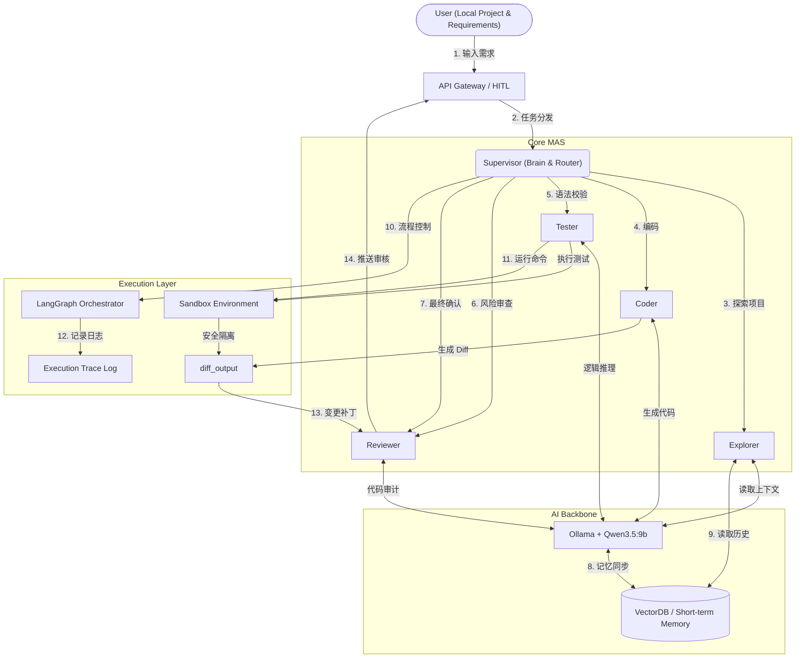

# Project Charter : Qwen9B Local Coding Agent Studio

## Project Name
Qwen9B Local Coding Agent Studio

## One-Sentence Positioning
A local multi-agent coding assistant powered by Qwen3.5:9B, capable of reading projects, generating code, running tests, reviewing changes, and producing reproducible execution traces within a controlled sandbox.

## Main Scenario
The user provides a local project directory and a development requirement, for example:
*"Add a user login endpoint to this Flask project, including routes, authentication logic, and unit tests."*

The system executes the following flow:
**Read project → Understand structure → Design solution → Generate code → Run tests → Review changes → Output final patch.**

## System Roles

| Role | Responsibility |
|---|---|
| **Supervisor** | Decomposes requirements, routes tasks, determines completion |
| **Explorer** | Reads files, analyzes project structure, locates relevant code |
| **Coder** | Generates or modifies code |
| **Tester** | Runs tests, checks syntax, verifies behavior |
| **Reviewer** | Reviews code quality, style, and potential risks |

## Key Tools

- **`read_file`**: Reads local code files, supporting text, images, CSV, Markdown, etc.
- **`write_file`**: Writes or modifies files in a specified directory.
- **`run_command`**: Executes commands in a sandbox, such as `pytest` or `python -m py_compile`.
- **`search_code`**: Searches for keywords or files within the project.
- **`diff_output`**: Generates diffs before and after changes for review.

## Safety Boundaries
Code execution must run inside a **Sandbox (沙箱)**; the Agent must not freely operate the host file system.
High-risk operations like writing files, running commands, or deleting files require **Human-in-the-Loop (人机协同/人工介入)** confirmation.

## Architecture Choice
Prioritize the **Supervisor + Worker (主管调度 + 工作节点)** pattern over Swarm.
**LangGraph** orchestrates state, loops, conditional branching, and **Checkpointing (断点续跑/状态持久化)**.
Qwen3.5:9B serves as the local inference backbone, called via Ollama + the OpenAI-compatible API.

## Success Metrics

- Capable of completing CRUD feature development for small projects.
- Every task produces a complete **Execution Trace (执行轨迹)** log.
- Generated code passes basic syntax checks and tests.
- Failed tasks can be traced back to the specific node.
- The Demo is reproducible and does not rely on temporary patches.

## Deliverables

- GitHub repository.
- **Architecture Diagram (架构图)**.
- Advanced runnable Coding Agent Demo.
- Sample execution trace logs.
- Evaluation task set.
- Technical documentation.

## Key Terminology Glossary

| English Term | 中文含义 | 备注 |
|---|---|---|
| **Multi-Agent System (MAS)** | 多智能体系统 | 多个 AI 角色协作完成任务 |
| **Supervisor** | 主管/协调者 | 负责任务拆解和路由的总控 Agent |
| **Worker** | 工作节点 | 执行具体任务的子 Agent |
| **Sandbox** | 沙箱 | 隔离的执行环境，防止代码破坏主机 |
| **Human-in-the-Loop (HITL)** | 人机协同/人工介入 | 关键步骤暂停，等人确认再继续 |
| **Execution Trace** | 执行轨迹 | 记录每一步决策和工具调用的日志 |
| **Checkpointing** | 断点续跑/状态持久化 | 任务中断后能从断点恢复 |
| **OpenAI-Compatible API** | OpenAI 兼容接口 | 让 Ollama 等模型能用 OpenAI SDK 调用 |
| **Inference Backbone** | 推理底座 | 提供核心推理能力的大模型 |
| **Patch** | 补丁/代码变更 | 修改后的代码差异片段 |
| **CRUD** | 增删改查 | Create, Read, Update, Delete 的缩写 |
| **Reproducible** | 可复现的 | 同样的输入能得到同样的结果 |

## System Architecture

